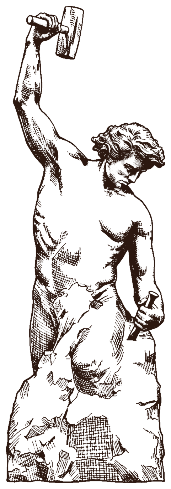

# Illustration helper

Last updated: 2026-10-26

This document explains how the poem and Physiology illustrations are processed,
where they live, how they are embedded in the paginated book, and what to check
when adding or replacing one.

The canonical processing pipeline is
[`tools/process-illustrations.sh`](tools/process-illustrations.sh). If this
document and the script disagree, update the script first, run it, then update
this document.

## Current state

- Source art: `public/illustrations/*.png` and `*.jpg`
- Processed art: `public/illustrations/processed/*.webp`
- Integration: `index.html`
- Presentation: `style.css`, section **Poem illustrations**
- Processing: ImageMagick 7 (`magick`, `identify`) and Bash
- 16 processed illustrations: 15 poems + Physiology, about 2.4 MB total.
- Missing artwork: **none**.
- The rail still has **46 points**. Illustration pages do not add rail points.
- At 1440×900 the book currently paginates to **61 pages**. At 390×844 it is
  **58 pages**. These counts are reference values, not requirements; they change
  whenever text, images, fonts, or viewport dimensions change.
- `Miss Cigarette` is **inverted** from a light-on-dark source. `Frenemy` has a
  watermark cleanup, and `Burden of Beast` uses a lower component threshold.
  Bee is now a normal line-art cutout. See [Special processing](#special-processing).
- The latest source batch is only about 700–1100px on its long edge. Output
  sharpness is limited by that; replace a source with a larger file and rerun if
  one becomes available.

## Visual preferences

- **Monochrome book ink**, not the original sepia/cream scan.
  Use `#2c1810`, the same ink as the body text.
- **Transparent background.** No cream/tan rectangle, no paper texture from the
  source, no frame, tape, border, or drop shadow.
- **Clean the paper.** Remove isolated specks and edge stains. The source paper
  has a vignette, stains, and occasionally white glare bands; those should
  become paper/page, not a visible background.
- **Keep the drawing's hatching and tonal variation.** Do not threshold the art
  into flat pure black/white. Alpha should carry the tone.
- **For normal cut-outs, the source colour and source alpha are discarded.**
  Even if the PNG is RGBA, the generated ink mask and book ink are authoritative.
  A wash output, if one is ever used, is the exception: it keeps a grayscale
  tonal range, toned to the same book ink.
- **Keep the figure directly after the piece in `index.html`.** This is the
  source order; it is not its final printed position.
- **A poem's illustration is placed according to the poem's page flow.**
  The paginator detects `article.poem + .illustration`, adds
  `.illustration--poem`, and then:
  - if the poem ends on a verso, the plate takes the facing recto;
  - if the poem overflows onto a recto and enough paper remains, the plate is
    scaled into that remaining recto space below the poem;
  - if the remaining recto space is too small, the plate takes the next verso.
  The Physiology illustration stays in ordinary flow after its list.
- **Wordsmith is the exception.** Its plate sits inline under the Philology
  heading on the title page, before the poem. The poem then starts on the next
  available page.
- **Allow a full book page.** A plate alone on a page is centred. The inline
  case sets a measured `--inline-h` so it occupies only the remaining space.
- **Do not remove `--ar` from a plate.** The paginator uses it to choose between
  inline and full-page placement and to size the inline image.
- **No visible source filename in the UI.** Use empty `alt=""` for these
  decorative illustrations unless a real description is added later.

## Tools

- ImageMagick 7.1.x with HDRI and WebP support:
  - `magick`
  - `identify`
- Bash 5+
- Python 3 + Pillow only for optional verification or updating dimensions in
  `index.html`.
- A local HTTP server for browser verification:
  - `python3 -m http.server 8765`
- Chrome and Firefox for responsive/pagination checks.

Confirm the tools:

```bash
magick -version
identify -version
```

## Why not a simple transparent colour key?

The source PNGs have a baked-in paper background with:

- different base tints (pale cream to orange-tan),
- a vignette,
- stains and paper grain,
- occasional white glare bands.

A command such as `-fuzz 10% -transparent '#f2e6c9'` will leave a tinted
rectangle or eat light linework. The script instead builds an ink mask from two
signals:

1. **Local paper estimate**: a large blur estimates the local paper tone;
   subtracting it removes the vignette and stains.
2. **Absolute darkness**: solid dark ink would disappear if only the local
   difference were used, so an absolute luminance mask is combined with it.

The mask is then cleaned, applied as alpha to flat book ink, cropped, and
exported as lossless WebP.

## Canonical processing pipeline

Run the full set:

```bash
tools/process-illustrations.sh
```

Run one source file:

```bash
ONLY='Wordsmith.png' tools/process-illustrations.sh
```

Keep intermediate masks for debugging:

```bash
KEEP=1 ONLY='Wordsmith.png' tools/process-illustrations.sh
```

`ONLY` must match the exact source filename, including `?` where present.
`KEEP=1` prints the temporary work directory instead of deleting it.

### The steps, in order

The following is the normal cut-out path. See [Special processing](#special-processing)
for the inverted Miss Cigarette, the Frenemy cleanup, and Burden's lower
component threshold.

For each normal source image:

1. **Build the mask**
   - Grayscale copy, blurred with `-blur 0x30` as the local paper estimate.
   - Grayscale copy, unblurred.
   - `MinusSrc` of blurred minus original (`B - G`), clamped.
   - `-level 2.75%,9.02%`.
   - Absolute mask: grayscale `-level 17.65%,78.43% -negate`.
   - `Lighten` combine the local and absolute masks.
   - `-level 9%,100%` to drop faint residue.
   - `-statistic Median 3x3`, then `-blur 0x0.4`.

2. **Clean isolated specks**
   - Threshold the mask at `8%`.
   - `-connected-components` with:
     - `area-threshold=2500`
     - `mean-color=true`
     - connectivity `8`
   - Multiply the original mask by the cleaned component mask.

   The large area threshold removes paper dots and edge stains. It can also
   remove very small detached decorations. The Modern Maze compass survives at
   `2500`; if a future image has intentional detached marks that disappear,
   lower the threshold and inspect the result carefully.

3. **Crop and tone**
   - `bbox` is read from the cleaned component mask with `%@`.
   - Crop the cut-out to `bbox` with `+repage`.
   - Colorize to `#2c1810`.
   - Apply the cleaned mask as alpha with `CopyOpacity`.
   - Write the cropped cut-out to a temporary PNG.

4. **Add margin and export**
   - In a **second** `magick` invocation, add `16px` of transparent border.
   - Resize only down to a long edge of `1400px` (`-resize '1400x1400>'`).
   - Strip metadata.
   - Export lossless WebP:
     `-define webp:lossless=true -define webp:method=6`.

### Important ImageMagick gotchas

These were observed while building the current set. Do not "simplify" them
without testing:

- **Do not put the source image at the front of the mask image stack.**
  `-composite` will treat it as an operand and the mask becomes wrong. The
  mask command must start with the two grayscale copies inside parentheses.
- **Do not combine `-crop`/`-border` with `CopyOpacity` in the same command.**
  ImageMagick 7 can turn the palette-alpha result into a flat GrayscaleAlpha
  image. Write the cropped cut-out first, then border/resize/export in a second
  invocation.
- **`-median 1` is deprecated** in current IM7; use `-statistic Median 3x3`.
- **Test on a page-coloured background**, not on white or black. A transparent
  PNG previewed on black will look like a solid black rectangle even when it is
  correct.

The mask command is:

```bash
magick \
  \( "$art_src" -colorspace Gray -blur 0x30 \) \
  \( "$art_src" -colorspace Gray \) \
  -compose MinusSrc -composite -clamp \
  -level 2.75%,9.02% \
  \( "$art_src" -colorspace Gray -level 17.65%,78.43% -negate \) \
  -compose Lighten -composite \
  -level 9%,100% \
  -statistic Median 3x3 \
  -blur 0x0.4 \
  "$mask"
```

The complete per-image sequence is below. `$art_src` is `$src` for a normal
cut-out, or the trimmed/negated temporary file for an inverted source.

```bash
# 1. Ink mask (above) -> $mask

# 2. Remove isolated paper specks.
magick "$mask" -threshold 8% \
  -define connected-components:area-threshold=2500 \
  -define connected-components:mean-color=true \
  -connected-components 8 \
  "$components"

magick "$mask" "$components" -compose Multiply -composite "$clean"

# 3. Crop to the cleaned drawing.
bbox="$(magick "$components" -format '%@' info:)"
crop_args=()
if [[ -n "$bbox" ]]; then
  crop_args=(-crop "$bbox" +repage)
fi

# 4. Flat book ink + the mask as alpha.
magick "$art_src" -alpha off \
  -fill '#2c1810' -colorize 100 \
  "$clean" -alpha off -compose CopyOpacity -composite \
  "${crop_args[@]}" \
  "$work/art.png"

# 5. Transparent margin, cap, and lossless WebP.
magick "$work/art.png" \
  -bordercolor none -border 16 \
  -resize '1400x1400>' \
  -strip \
  -define webp:lossless=true -define webp:method=6 \
  "$out"
```

## Special processing

Most sources are dark drawings on paper and use the normal cut-out path. The
current exceptions are:

| Source | Mode | Why | Output |
|---|---|---|---|
| `Miss_cigrate.png` | **invert** | Light smoke and cigarette on a near-black field. A normal cut-out would preserve a solid black poster rectangle. | `miss-cigarette.webp`, 236×449 |
| `Frenemy.jpg` | **cleanup** | The JPG carries a small `Grok` watermark in the lower-right paper. The cleanup paints over that paper-only corner before masking. | `frenemy.webp`, 858×1190 |
| `BurdenOfBeast.jpg` | **area=100** | Clean, already-cut line art. The default component threshold of 2500 removes short facial strokes. | `burden-of-beast.webp`, 366×694 |
| `Bee.png` | normal | Now a detailed line drawing on paper, not a soft wash. It uses the normal cut-out path. | `bee.webp`, 1022×958 |

### Invert mode

Before masking:

```bash
magick "$src" -fuzz 8% -trim +repage -shave 3x3 +repage \
  -colorspace Gray -negate \
  "$work/inverted.png"
```

- `-trim` removes the cream paper border around the dark field.
- `-shave 3x3` removes the thin dark edge left at the border.
- `-negate` turns light strokes into dark ink; the black field becomes paper.
- The normal mask/crop/ink/WebP steps then run unchanged.

Use this only when the drawing is genuinely light-on-dark. If a dark field is
part of the picture, not a background, do not invert it.

### Cleanup regions

`Frenemy.jpg` has a watermark in otherwise empty paper. The `cleanup` map paints
a page-toned rectangle over that region before the mask:

```bash
declare -A cleanup=(
  ["Frenemy.jpg"]="755 1140 847 1215"
)
```

The four numbers are `x1 y1 x2 y2`. Use this only when the covered region is
paper, not part of the drawing. The cleanup still crops to the art afterward,
so the filled paper disappears with the rest of the background.

### Small-stroke area threshold

The normal component filter uses `area-threshold=2500`. Clean line art may have
intentional face or detail strokes smaller than that. `BurdenOfBeast.jpg` opts
down to 100:

```bash
declare -A area=(
  ["BurdenOfBeast.jpg"]=100
)
```

Use a low threshold only on a source with a clean paper background; otherwise
paper specks survive.

### Wash mode

The script still has a `wash` path for a future continuous-tone painting, but
the map is currently empty. Bee now uses the normal line-art path. A wash output
is toned from `#2c1810` to white and needs `class="illustration illustration--wash"`
plus `mix-blend-mode: multiply`; see the script if a soft source is ever added.
Do not use wash on a line drawing.

## Source-to-output map

Current dimensions are from the processed WebPs. The crop is based on the
cleaned component mask, so dimensions can change if the processing thresholds
or source art change. Always read the new size from `identify` and update
`index.html` accordingly.

| Source in `public/illustrations/` | Output in `processed/` | Placement | Current size |
|---|---|---|---|
| `Wordsmith.png` | `wordsmith.webp` | `poem-1` | 481×1372 |
| `TheModernMaze.png` | `the-modern-maze.webp` | `poem-2` | 864×721 |
| `Strom_within.png` | `strom-within.webp` | `poem-3` | 515×425 |
| `Am_I.png` | `am-i.webp` | `poem-4` | 513×344 |
| `The_autumn_leaf.png` | `the-autumn-leaf.webp` | `poem-5` | 425×506 |
| `Reverie.png` | `reverie.webp` | `poem-6` | 499×513 |
| `Frivolous_love.png` | `frivolous-love.webp` | `poem-7` | 639×901 |
| `Metamorphosis.png` | `metamorphosis.webp` | `poem-8` | 590×1191 |
| `The_Moon-a_Man.png` | `the-moon-a-man.webp` | `poem-9` | 899×1006 |
| `An_early_morning_jest.png` | `an-early-morning-jest.webp` | `poem-10` | 928×890 |
| `BurdenOfBeast.jpg` | `burden-of-beast.webp` | `poem-11` | 366×694 |
| `Bee.png` | `bee.webp` | `poem-12` | 1022×958 |
| `Miss_cigrate.png` | `miss-cigarette.webp` | `poem-13` | 236×449 |
| `Ascendance.png` | `ascendance.webp` | `poem-14` | 878×1150 |
| `Frenemy.jpg` | `frenemy.webp` | `poem-15` | 858×1190 |
| `Physiology.png` | `physiology.webp` | Physiology entry | 937×740 |

Missing source art: none. Every poem now has an illustration.

## Adding a new illustration

1. Put the source PNG in `public/illustrations/`. Preserve the original; do not
   overwrite the processed WebP by hand.
2. Add the source-to-slug mapping in `tools/process-illustrations.sh`:
   ```bash
   ["New_File.png"]="new-slug"
   ```
   Output slugs must be lowercase and URL-safe. Remove or replace `?`, spaces,
   and punctuation.
3. Decide the mode:
   - dark drawing on light paper → normal (do nothing);
   - light strokes on a dark field → add the source to `invert`;
   - soft/continuous-tone painting → add the source to `wash`.
4. Run:
   ```bash
   ONLY='New_File.png' tools/process-illustrations.sh
   ```
   The script prints the output path and dimensions.
5. Add the figure after the relevant content in `index.html`. For a poem, put it
   after that poem's closing `</article>`; for Physiology, after the list inside
   the Physiology entry. Use `class="illustration illustration--wash"` for a
   wash, and plain `class="illustration"` otherwise. Do not add
   `illustration--poem` by hand; the paginator adds it to figures immediately
   following a poem and uses it to choose recto, inline, or next-verso
   placement. The Wordsmith figure is also detected by its `poem-1` slug and
   moved before the poem in the paginated clone.
6. Use the current output dimensions and compute `--ar`:
   ```html
   <figure class="illustration">
     
   </figure>
   ```
   `--ar` must be the decimal `width / height` (for example,
   `style="--ar: 0.350583"`).
7. Do not add a caption or heading for the image unless you intentionally want a
   new rail point. The rail count is currently **46** and is built from titles.
8. Verify in the browser (see checklist below).

## Replacing or updating an old illustration

1. Replace the source file with the same filename, or add a new mapping if the
   filename changes.
2. Run the full script or `ONLY=...`.
3. If the processed dimensions changed, update **all of**:
   - `width`
   - `height`
   - `style="--ar: ..."`
   in the corresponding `` in `index.html`.
4. If the dimensions are unchanged, the HTML can stay as-is. Hard-refresh the
   browser to bypass the cached WebP.
5. Re-run the responsive/pagination checks. An aspect-ratio change alters page
   flow, rail page targets, and old `#/p/N` links.

## The HTML/CSS contract

The figure is a normal, unsplittable block in the reading flow, inserted after
the content. The paginator handles it; no per-image `script.js` changes are
required.

```html
<figure class="illustration">
  
</figure>
```

CSS lives in `style.css` under **Poem illustrations**:

```css
.illustration {
  margin: 1.5rem 0 0;
  text-align: center;
}

.illustration img {
  display: block;
  width: min(100%, calc((100vh - 7rem) * var(--ar)));
  width: min(100%, calc((100svh - 7rem) * var(--ar)));
  max-width: 100%;
  max-height: calc(100svh - 7rem);
  aspect-ratio: var(--ar);
  height: auto;
  margin: 0 auto;
}

.page-content:has(> .illustration:only-child) {
  display: flex;
  flex-direction: column;
  justify-content: center;
}

.illustration:only-child {
  margin: 0;
}

.illustration--wash img {
  mix-blend-mode: multiply;
}

.illustration--inline img {
  width: calc(var(--inline-h) * var(--ar));
  height: var(--inline-h);
  max-width: 100%;
  max-height: none;
}
```

Why `--ar` is mandatory: the paginator measures the page before the image has
loaded. Without the explicit aspect ratio and width calculation, the ``
measures as zero-height, the paginator packs text into the page, and the loaded
image later clips or overflows. The `width`/`height` attributes alone are not
enough with the CSS sizing used here.

The print block also resets the width fit:

```css
@media print {
  .illustration img {
    width: auto;
    max-width: 100%;
    max-height: 8.5in;
    aspect-ratio: auto;
  }
}
```

## Pagination and rail effects

- The `.illustration` figure is not a `.plate`; it has no frame, tape, or
  shadow.
- It is unsplittable. Placement depends on the poem's last page:
  - **poem ends on a verso** → full plate on the next recto;
  - **poem ends on a recto with enough paper** → inline plate, scaled to the
    measured remaining height; the code requires roughly a third of the page
    height and a third of the measure to call the space ample;
  - **poem ends on a recto with too little paper** → full plate on the next
    verso, leaving the poem's recto untouched.
- **Wordsmith** is placed inline under the Philology heading on the left title
  page, before the poem; the poem follows on the next page. This is intentional,
  not a bug.
- A plate alone on a page is vertically centred. An inline plate keeps the
  poem text above it and gets `--inline-h` from the measured space.
- Without JS there is no pagination, so the manuscript stays linear and each
  poem plate remains after its poem. Recto/inline placement is a paged-book
  behaviour.
- The Physiology illustration is not marked as a poem plate and remains in
  normal flow.
- Phronesis/other sections do not have illustrations yet.
- The rail is rebuilt from titles; illustrations add no points. It should remain
  **46 points** unless titles are added or removed.
- Existing `#/p/N` deep links shift whenever page count changes. Slug links such
  as `#physiology` and `#philology` still work.

## Verification checklist

Run these after any image update:

1. **Shell and script sanity**
   ```bash
   bash -n tools/process-illustrations.sh
   node --check script.js
   git diff --check
   ```

2. **Processed assets**
   ```bash
   magick identify -format '%f %wx%h\n' public/illustrations/processed/*.webp
   ```
   Confirm every processed file has alpha and is not black/empty:
   ```bash
   magick identify -format '%f %[type] %[fx:mean.a]\n' public/illustrations/processed/*.webp
   ```

3. **HTML matches the assets**
   - For each illustration, the `width`, `height`, and `--ar` in `index.html`
     must match the processed WebP.
   - `--ar` is `width / height`, to about six decimals.

4. **Desktop**
   ```bash
   python3 -m http.server 8765
   ```
   Load `http://localhost:8765/` at 1440×900.
   - No console errors.
   - Rail still has 46 points.
   - No page has `page-content.scrollHeight > page-content.clientHeight + 1`.
   - `document.documentElement.scrollWidth === innerWidth` (no horizontal
     overflow).
   - Every illustration has a sensible rendered size and is fully inside its
     page.
   - The page count is reasonable (61 at 1440×900 at the time of writing, but
     may change with content).

5. **Mobile / one-up**
   - Check 390×844 and at least one landscape phone size such as 844×390.
   - Same overflow and rail checks.
   - Images that are alone on a page should be centred and fully visible.

6. **Images blocked**
   - Block `*illustrations/processed/*` and reload.
   - The book should still paginate to the same page count with no overflow,
     proving the aspect-ratio placeholders work.

7. **No-JS**
   - Disable JavaScript and reload.
   - All 16 figures should appear in the manuscript and the rail should be
     hidden.

8. **Firefox**
   - Load and repeat the page-overflow and rail checks.
   - Firefox's `svh` depends on its viewport; page count can legitimately differ
     from Chrome.

9. **Rail navigation**
   - Click a poem's rail point and a following spread.
   - Confirm the hash is a valid `#/p/N`, the page lands at a spread boundary,
     and the active rail point is sensible.

## Troubleshooting

### The processed image is solid black or empty

The mask stack or the border step is wrong. Check:
- the mask command starts with the blurred and unblurred grayscale copies, not
  the colour source;
- the cropped cut-out is written to a PNG before `-border`/WebP;
- the preview is composited on the page colour, not viewed on black.

### There is a cream rectangle or a tinted edge

- The local background estimate is too small; increase `-blur 0x30`.
- The component pass is leaving a connected paper region. Inspect the mask and
  consider a higher `area-threshold`, a lower/higher threshold percentage, or a
  manual crop.
- Do not solve this by matching the source paper colour; the page has its own
  texture and gradients.

### Specks or stains remain

- Raise the connected-component `area-threshold` in
  `tools/process-illustrations.sh`.
- Check whether the remaining mark is part of the drawing before removing it.
- Do not use a large median filter on the final colour image; it softens the
  hatching.

### An intentional small detached mark disappeared

The `area-threshold=2500` component filter removed it. Lower the threshold for
that image or process that mark separately. The Modern Maze compass is a known
detached element that currently survives.

### The image overflows or clips its page

- Missing or wrong `--ar` on the ``.
- `width`/`height` attributes do not match the processed file.
- The CSS `.illustration img` rule was changed and no longer reserves height.
- The page was paginated before the image loaded and the CSS aspect ratio is
  absent.

### The image is too large/small on a page

For a full plate, the CSS caps the long edge at `100svh - 7rem` and width at the
page content width. Portrait images become narrow; landscape images fill the
width. Inline plates use the measured `--inline-h` instead. Change the `7rem`
value only if the page padding changes; verify full-page and inline plates at
short viewport heights.

### A page is blank beside an illustration

A full poem plate only goes to the next verso when the remaining recto paper is
too small for an inline plate. If the poem ends on a recto with ample space, the
plate is scaled into that page instead. Blank versos can also come from the
normal poem-start rhythm, not from the plate.

### Old `#/p/N` links point at the wrong page

Expected after reflow. Page-number links are not stable across illustration
changes. Use the rail or slug links (`#philology`, `#physiology`) for stable
targets.

## Do not

- Do not hand-paint or hand-erase the processed WebP; update the source and
  rerun the script.
- Do not use a single-colour `-transparent` key.
- Do not add a frame, shadow, tape, border, or cream background to "match" the
  page.
- Do not add an `alt` description unless one is supplied; these are decorative.
- Do not add a caption/heading to an illustration without checking the rail
  point count.
- Do not forget `--ar`; it is the reason pagination is stable.
- Do not assume page count or page indices are fixed.
